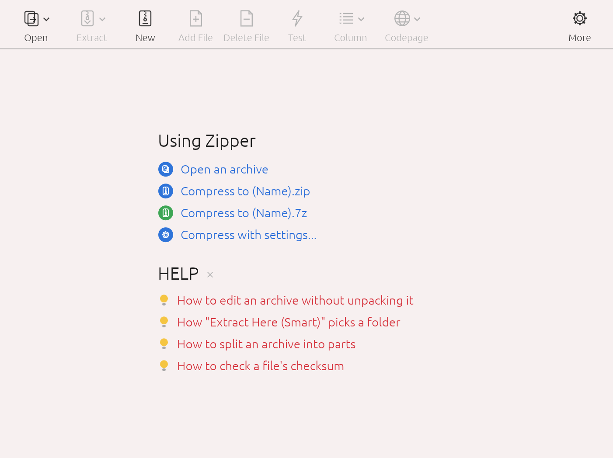

<p align="center">
  <a href="README.md">한국어</a> · <b>English</b> · <a href="README.zh-CN.md">中文</a> · <a href="README.ja.md">日本語</a>
</p>

<p align="center">
  
</p>

<h1 align="center">Zipper</h1>

<p align="center">
  Archive utility for macOS · Create ZIP & 7Z · Extract RAR, EGG, ALZ · File names that stay intact<br>
  <a href="https://github.com/jayusop/Zipper/releases/latest"><b>⬇ Download the latest version</b></a> ·
  <a href="https://jayusop.github.io/Zipper/en/">Website</a>
</p>

<p align="center">
  
  
  
  
</p>

---

A macOS archive utility that creates ZIP, 7Z and TAR archives and extracts RAR, EGG, ALZ, ISO and 30+ other formats. File names are stored the way Windows expects, so they never come out garbled.

> Requirements: macOS 12 or later (Universal: Apple Silicon / Intel)<br>
> 🌐 The app follows your macOS language: Korean, English, Chinese (Simplified) or Japanese; English otherwise.

<p align="center"></p>

## Installation

1. **Download** — Get the latest `Zipper.app.zip` from the [GitHub Releases page](https://github.com/jayusop/Zipper/releases/latest) and unzip it.
2. **Move to Applications** — Drag `Zipper.app` into the `Applications` folder.
3. **Open it the first time** — Zipper is an independently distributed app that is not notarized by Apple, so macOS shows a warning the first time. Don't click **Move to Trash** — close it with **Done** (**Cancel** on macOS 14 and earlier), then click **Open Anyway** at the bottom of `System Settings → Privacy & Security`.

   If you prefer Terminal, this one line does the same:
   ```bash
   xattr -dr com.apple.quarantine /Applications/Zipper.app
   ```

## Features

| Area | Features |
|---|---|
| Compress | Create ZIP, 7Z, TAR, TGZ, TBZ, TXZ, GZ; drop files on the window; Quick ZIP / Quick 7Z; levels Store/Fast/Normal/Maximum; split into parts (25 MB, CD, DVD, FAT32 …); exclude filter |
| Extract | 30+ formats, Smart extract, multi-part and EXE self-extracting archives, automatic code-page detection |
| Edit | Add, delete and rename files inside a ZIP without unpacking; new folder |
| Security | AES-256 for ZIP and 7Z, encrypted 7Z file names, extract encrypted EGG (AES/LEA), ALZ and RAR |
| Tools | Integrity test, file checksums (CRC32, MD5, SHA-1, SHA-256) |
| Other | NFC file names, leaves out .DS_Store and __MACOSX, light/dark theme, Korean/English/Chinese/Japanese UI |

## Supported formats

- **Create · Extract · Test**: ZIP · 7Z · TAR · TGZ · TBZ · TXZ · GZ
- **Open · Extract · Test**: RAR / RAR5 · EGG · ALZ · ISO · UDF · BIN · IMG (FAT) · CAB · MSI · LZH / LHA · ARJ · ACE · ARC · ZOO · HA · BZ2 · XZ · ZST · LZMA · LZ · Z · AES · TZST · TLZ · TAZ · EXE (SFX) · JAR / APK / IPA / EPUB

ZIP archives can be edited in place. Split archives (.001, .z01, .a00, .vol1.egg, RAR volumes) and ZIP/7Z/RAR/ALZ/EGG inside EXE self-extractors also open.

## Use it with confidence

- **No internet connection**: everything happens on your Mac; no files or data ever leave it.
- **Deletions go to the Trash**: deleted archives and files are moved to the Trash by default (changeable in Preferences). If that fails, Zipper tells you instead of deleting permanently.
- **Windows-friendly**: non-English file names display correctly in File Explorer.

## License

Zipper is **completely free freeware for individuals and businesses**. No fee, registration or license key.

- Personal, home, business, government and school use are all allowed (any number of computers).
- You may redistribute the unmodified original for free, together with the license.
- **The only restriction is reverse engineering** — no decompiling, disassembling, modifying or patching the app (except where law grants a right that cannot be waived).
- Provided "as is" without warranty. No personal data is collected.
- Open-source components included in the app remain under their own licenses; notices are in Preferences › Licenses.

Full text: [LICENSE](LICENSE) (English original) · [LICENSE.ko.md](LICENSE.ko.md) (Korean translation)

## Credits & contact

- ALZ format: based on [unalz](https://github.com/kippler/unalz) (kippler, zlib license)
- RAR extraction: UnRAR source code (Alexander Roshal) — may not be used to re-create the RAR compression algorithm
- Bug reports: [Issues](https://github.com/jayusop/Zipper/issues) · jayusop@gmail.com
