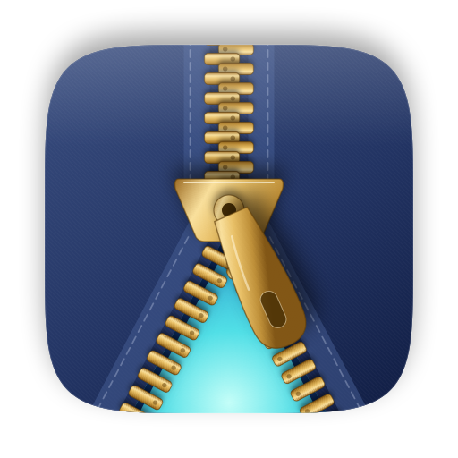
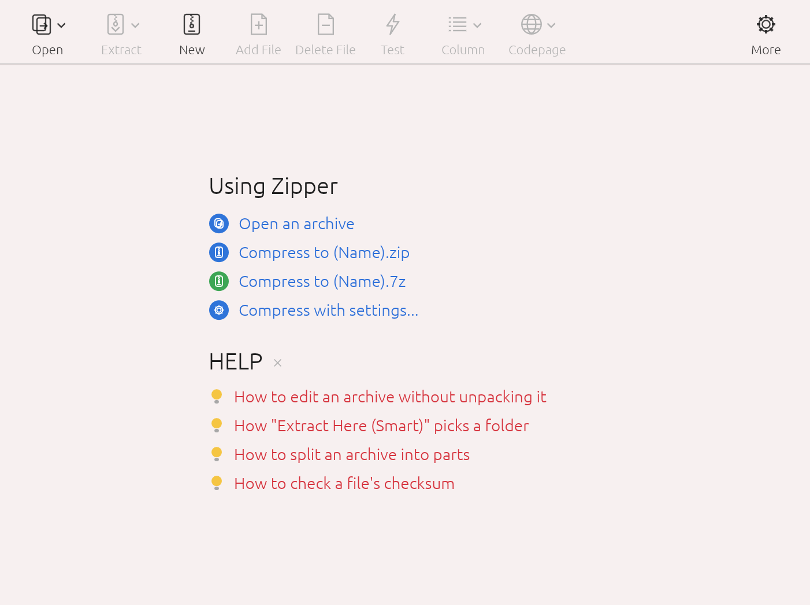

<p align="center">
  <a href="README.md">한국어</a> · <a href="README.en.md">English</a> · <a href="README.zh-CN.md">中文</a> · <b>日本語</b>
</p>

<p align="center">
  
</p>

<h1 align="center">Zipper</h1>

<p align="center">
  macOS 用圧縮ソフト · ZIP・7Z 作成 · RAR・EGG・ALZ 展開 · 文字化けしないファイル名<br>
  <a href="https://github.com/jayusop/Zipper/releases/latest"><b>⬇ 最新版をダウンロード</b></a> ·
  <a href="https://jayusop.github.io/Zipper/ja/">紹介ページ</a>
</p>

<p align="center">
  
  
  
  
</p>

---

ZIP、7Z、TAR を作成し、RAR、EGG、ALZ、ISO など 30 以上の形式を展開できる macOS 用圧縮ソフトです。ファイル名を Windows が想定する形式で保存するため、文字化けしません。

> 動作環境：macOS 12 以降（ユニバーサル：Apple Silicon / Intel）<br>
> 🌐 アプリの言語は macOS のシステム言語に従います：韓国語、英語、簡体字中国語、日本語。それ以外は英語で表示されます。

<p align="center"></p>

## インストール

1. **ダウンロード** — [GitHub のリリースページ](https://github.com/jayusop/Zipper/releases/latest)から最新の `Zipper.app.zip` をダウンロードして展開します。
2. **「アプリケーション」へ移動** — `Zipper.app` を「アプリケーション」フォルダにドラッグします。
3. **初回の起動** — Apple の公証を受けていない個人配布アプリのため、初回起動時に警告が表示されます。**ゴミ箱に入れる** は押さずに **完了**（macOS 14 以前は **キャンセル**）で閉じ、`システム設定 → プライバシーとセキュリティ` の下部にある **このまま開く** をクリックします。

   ターミナルを使う場合は、次の 1 行でも同じです。
   ```bash
   xattr -dr com.apple.quarantine /Applications/Zipper.app
   ```

## 機能

| 分類 | 機能 |
|---|---|
| 圧縮 | ZIP・7Z・TAR・TGZ・TBZ・TXZ・GZ の作成、ウインドウへのドロップで圧縮、クイック ZIP/7Z 圧縮、圧縮レベル（無圧縮/高速/標準/最大）、分割圧縮（25MB・CD・DVD・FAT32 など）、除外フィルタ |
| 展開 | 30 以上の形式、スマート展開、分割ファイル・EXE 自己解凍ファイル、コードページ自動検出 |
| 編集 | ZIP を展開せずにファイルの追加・削除・名前変更、新規フォルダ |
| セキュリティ | ZIP・7Z の AES-256 暗号化、7Z のファイル名暗号化、暗号化 EGG（AES/LEA）・ALZ・RAR の展開 |
| ツール | 整合性テスト、ファイルチェックサム（CRC32・MD5・SHA-1・SHA-256） |
| その他 | NFC ファイル名、.DS_Store・__MACOSX の除外、ライト/ダークテーマ、日英韓中 UI |

## 対応形式

- **作成・展開・テスト**: ZIP · 7Z · TAR · TGZ · TBZ · TXZ · GZ
- **開く・展開・テスト**: RAR / RAR5 · EGG · ALZ · ISO · UDF · BIN · IMG (FAT) · CAB · MSI · LZH / LHA · ARJ · ACE · ARC · ZOO · HA · BZ2 · XZ · ZST · LZMA · LZ · Z · AES · TZST · TLZ · TAZ · EXE (SFX) · JAR / APK / IPA / EPUB

ZIP は展開せずにその場で編集できます。分割アーカイブ（.001、.z01、.a00、.vol1.egg、RAR ボリューム）や、EXE 自己解凍ファイル内の ZIP/7Z/RAR/ALZ/EGG も開けます。

## 安心してお使いください

- **インターネットに接続しません**：すべての処理は Mac の中だけで行われ、ファイルや情報を外部に送りません。
- **削除はゴミ箱へ**：削除したアーカイブやファイルは既定でゴミ箱に移動します（環境設定で変更可）。移動できない場合は完全に削除せず、お知らせします。
- **Windows と互換**：日本語などのファイル名がエクスプローラーでも正しく表示されます。

## ライセンス

Zipper は**個人・法人を問わず完全無料**のフリーウェアです。料金、登録、ライセンスキーは不要です。

- 個人・家庭はもちろん、会社・団体・学校などの業務・商用利用も可能です（台数制限なし）。
- 改変していないオリジナルをライセンスとともに無料で再配布できます。
- **唯一禁止されているのはリバースエンジニアリングです** — 逆コンパイル・逆アセンブル、実行ファイルの改変・パッチは禁止です（法律が契約で制限できないと定める範囲は除く）。
- 「現状のまま」提供され、いかなる保証もしません。個人情報は収集しません。
- アプリに含まれるオープンソースコンポーネントはそれぞれのライセンスに従い、表示は 環境設定 › ライセンス で確認できます。

全文: [LICENSE](LICENSE) (英語原文) · [LICENSE.ko.md](LICENSE.ko.md) (韓国語訳)

## クレジット & お問い合わせ

- ALZ 形式：[unalz](https://github.com/kippler/unalz)（kippler、zlib ライセンス）を参考
- RAR 展開：UnRAR ソースコード（Alexander Roshal）— RAR 圧縮アルゴリズムの再現には使用できません
- 不具合報告：[Issues](https://github.com/jayusop/Zipper/issues) · jayusop@gmail.com
