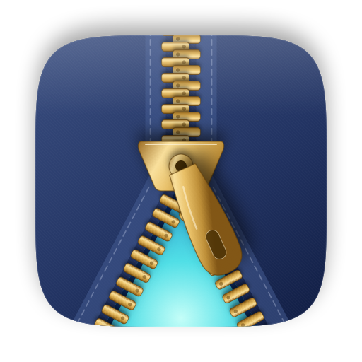
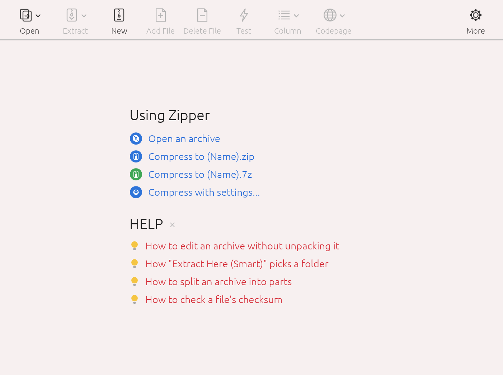

<p align="center">
  <b>한국어</b> · <a href="README.en.md">English</a> · <a href="README.zh-CN.md">中文</a> · <a href="README.ja.md">日本語</a>
</p>

<p align="center">
  
</p>

<h1 align="center">Zipper</h1>

<p align="center">
  macOS 압축 프로그램 · ZIP·7Z 만들기 · RAR·EGG·ALZ 풀기 · 한글 파일명 깨짐 방지<br>
  <a href="https://github.com/jayusop/Zipper/releases/latest"><b>⬇ 최신 버전 다운로드</b></a> ·
  <a href="https://jayusop.github.io/Zipper/">소개 페이지</a>
</p>

<p align="center">
  
  
  
  
</p>

---

ZIP, 7Z, TAR를 만들고 RAR, EGG, ALZ, ISO 등 30여 가지 형식을 푸는 macOS용 압축 프로그램입니다. 파일 이름을 Windows가 읽는 방식으로 저장해 한글 이름이 깨지지 않습니다.

> 요구 사항: macOS 12 이상 (Apple Silicon / Intel 유니버설)<br>
> 🌐 앱 언어는 macOS 시스템 언어를 따릅니다: 한국어, 영어, 중국어(간체), 일본어. 그 외 언어에서는 영어로 표시됩니다.

<p align="center"></p>

## 설치

1. **다운로드** — [GitHub 릴리스 페이지](https://github.com/jayusop/Zipper/releases/latest)에서 최신 `Zipper.app.zip`을 내려받아 압축을 풉니다.
2. **응용 프로그램 폴더로 옮기기** — `Zipper.app`을 `응용 프로그램` 폴더로 드래그합니다.
3. **처음 한 번 열기** — Apple 공증을 받지 않은 개인 배포 앱이라 처음 열 때 보안 경고가 뜹니다. **휴지통으로 이동**은 누르지 말고 **완료**(macOS 14 이하는 **취소**)로 닫은 뒤, `시스템 설정 → 개인정보 보호 및 보안` 아래쪽의 **그래도 열기**를 클릭하세요.

   터미널을 쓴다면 다음 명령 한 줄로도 됩니다.
   ```bash
   xattr -dr com.apple.quarantine /Applications/Zipper.app
   ```

## 기능

| 영역 | 기능 |
|---|---|
| 압축 | ZIP·7Z·TAR·TGZ·TBZ·TXZ·GZ 만들기, 창에 끌어다 놓아 압축, 빠른 ZIP·7Z 압축, 압축 수준(저장/빠르게/보통/최대), 분할 압축(25MB·CD·DVD·FAT32 등), 제외 필터 |
| 풀기 | 30여 가지 형식, 스마트 풀기, 분할 파일·EXE 자동 풀림 파일 열기, 코드페이지 자동 감지 |
| 편집 | ZIP을 풀지 않고 파일 추가·삭제·이름 바꾸기, 새 폴더 |
| 보안 | ZIP·7Z AES-256 암호화, 7Z 파일 이름 암호화, 암호화된 EGG(AES/LEA)·ALZ·RAR 풀기 |
| 도구 | 무결성 테스트, 파일 체크섬(CRC32·MD5·SHA-1·SHA-256) |
| 기타 | 한글 파일명 NFC 저장, .DS_Store·__MACOSX 제외, 라이트/다크 테마, 한국어·영어·중국어·일본어 UI |

## 지원 형식

- **만들기 · 풀기 · 테스트**: ZIP · 7Z · TAR · TGZ · TBZ · TXZ · GZ
- **열기 · 풀기 · 테스트**: RAR / RAR5 · EGG · ALZ · ISO · UDF · BIN · IMG (FAT) · CAB · MSI · LZH / LHA · ARJ · ACE · ARC · ZOO · HA · BZ2 · XZ · ZST · LZMA · LZ · Z · AES · TZST · TLZ · TAZ · EXE (SFX) · JAR / APK / IPA / EPUB

ZIP 파일은 압축을 풀지 않고 바로 편집할 수 있습니다. 분할 압축(.001, .z01, .a00, .vol1.egg, RAR 볼륨)과 EXE 자동 풀림 파일 안의 ZIP/7Z/RAR/ALZ/EGG도 열 수 있습니다.

## 안심하고 쓰세요

- **인터넷에 연결하지 않습니다**: 모든 작업은 Mac 안에서만 이루어지며 파일이나 정보를 외부로 보내지 않습니다.
- **삭제는 휴지통으로**: 삭제한 압축 파일과 파일은 기본으로 휴지통에 옮깁니다(환경설정에서 변경). 휴지통으로 옮기지 못하면 영구 삭제하지 않고 알려 줍니다.
- **Windows와 호환**: 한글 등 비영어 파일 이름이 Windows 탐색기에서도 그대로 보입니다.

## 라이선스

**개인·기업 모두 완전 무료**인 프리웨어입니다. 요금, 등록, 라이선스 키가 필요 없습니다.

- 개인·가정은 물론 회사·기관·학교 등 업무용·상업적 사용 모두 가능합니다 (대수 제한 없음).
- 수정하지 않은 원본을 라이선스와 함께 무료로 재배포할 수 있습니다.
- **유일하게 금지되는 것은 리버스 엔지니어링입니다** — 디컴파일·디스어셈블, 실행 파일 수정·패치 금지 (법이 계약으로 제한할 수 없다고 정한 범위는 예외).
- "있는 그대로" 제공되며 어떠한 보증도 하지 않습니다. 개인정보를 수집하지 않습니다.
- 앱에 포함된 오픈 소스 구성 요소는 각자의 라이선스를 따르며, 고지 내용은 앱의 환경설정 › 라이센스에서 볼 수 있습니다.

전문: [LICENSE](LICENSE) (영어 원문) · [LICENSE.ko.md](LICENSE.ko.md) (한국어 번역)

## 크레딧 & 문의

- ALZ 형식 해석: [unalz](https://github.com/kippler/unalz) (kippler, zlib 라이선스) 참고
- RAR 풀기: UnRAR 소스 코드 (Alexander Roshal) — RAR 압축 알고리즘을 재현하는 데 사용할 수 없습니다
- 버그 신고: [Issues](https://github.com/jayusop/Zipper/issues) · 메일 jayusop@gmail.com
