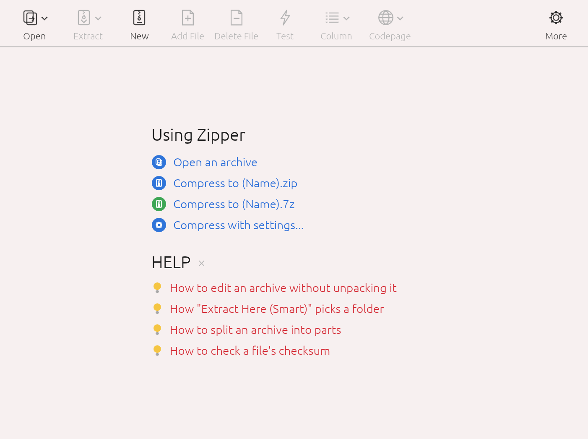

<p align="center">
  <a href="README.md">한국어</a> · <a href="README.en.md">English</a> · <b>中文</b> · <a href="README.ja.md">日本語</a>
</p>

<p align="center">
  
</p>

<h1 align="center">Zipper</h1>

<p align="center">
  macOS 压缩软件 · 创建 ZIP、7Z · 解压 RAR、EGG、ALZ · 文件名不乱码<br>
  <a href="https://github.com/jayusop/Zipper/releases/latest"><b>⬇ 下载最新版本</b></a> ·
  <a href="https://jayusop.github.io/Zipper/zh/">介绍页面</a>
</p>

<p align="center">
  
  
  
  
</p>

---

一款 macOS 压缩软件，可创建 ZIP、7Z、TAR，并解压 RAR、EGG、ALZ、ISO 等 30 多种格式。文件名按 Windows 期望的方式保存，不会乱码。

> 系统要求：macOS 12 或更高版本（通用版：Apple Silicon / Intel）<br>
> 🌐 应用语言跟随 macOS 系统语言：韩语、英语、简体中文、日语；其他语言显示为英语。

<p align="center"></p>

## 安装

1. **下载** — 从 [GitHub Releases 页面](https://github.com/jayusop/Zipper/releases/latest)下载最新的 `Zipper.app.zip` 并解压。
2. **移到“应用程序”** — 将 `Zipper.app` 拖到“应用程序”文件夹。
3. **首次打开** — 这是未经 Apple 公证的个人发布应用，首次打开时会出现安全提示。请不要点按 **移到废纸篓**，点按 **完成**（macOS 14 及更早版本为 **取消**）关闭，然后在 `系统设置 → 隐私与安全性` 底部点按 **仍要打开**。

   如果使用终端，也可以运行这一行命令：
   ```bash
   xattr -dr com.apple.quarantine /Applications/Zipper.app
   ```

## 功能

| 类别 | 功能 |
|---|---|
| 压缩 | 创建 ZIP、7Z、TAR、TGZ、TBZ、TXZ、GZ；拖放到窗口压缩；快速 ZIP/7Z 压缩；压缩级别（存储/快速/标准/最大）；分卷（25MB、CD、DVD、FAT32 等）；排除过滤 |
| 解压 | 30 多种格式、智能解压、分卷与 EXE 自解压文件、自动识别代码页 |
| 编辑 | 无需解压即可在 ZIP 中添加、删除、重命名文件，新建文件夹 |
| 安全 | ZIP、7Z 的 AES-256 加密，7Z 文件名加密，解压加密的 EGG（AES/LEA）、ALZ、RAR |
| 工具 | 完整性测试、文件校验和（CRC32、MD5、SHA-1、SHA-256） |
| 其他 | NFC 文件名、排除 .DS_Store 和 __MACOSX、浅色/深色主题、韩英中日界面 |

## 支持格式

- **创建 · 解压 · 测试**: ZIP · 7Z · TAR · TGZ · TBZ · TXZ · GZ
- **打开 · 解压 · 测试**: RAR / RAR5 · EGG · ALZ · ISO · UDF · BIN · IMG (FAT) · CAB · MSI · LZH / LHA · ARJ · ACE · ARC · ZOO · HA · BZ2 · XZ · ZST · LZMA · LZ · Z · AES · TZST · TLZ · TAZ · EXE (SFX) · JAR / APK / IPA / EPUB

ZIP 文件可直接编辑而无需解压。也可打开分卷压缩（.001、.z01、.a00、.vol1.egg、RAR 分卷）以及 EXE 自解压文件中的 ZIP/7Z/RAR/ALZ/EGG。

## 放心使用

- **不联网**：所有操作都在你的 Mac 上完成，文件和数据不会外传。
- **删除进入废纸篓**：删除的压缩文件和文件默认移到废纸篓（可在偏好设置中更改）。无法移到废纸篓时会提示，而不会永久删除。
- **兼容 Windows**：非英文文件名在文件资源管理器中正常显示。

## 许可证

Zipper 是**个人和企业均可完全免费使用**的免费软件。无需付费、注册或许可证密钥。

- 个人、家庭以及公司、机构、学校等业务和商业用途均可使用（不限台数）。
- 可将未经修改的原版连同许可证一起免费再分发。
- **唯一禁止的是逆向工程** —— 禁止反编译、反汇编、修改或修补应用（法律规定不可通过合同限制的情形除外）。
- 按“原样”提供，不作任何保证。不收集个人信息。
- 应用中包含的开源组件遵循各自的许可证，声明可在 偏好设置 › 许可证 中查看。

全文: [LICENSE](LICENSE) (英文原文) · [LICENSE.ko.md](LICENSE.ko.md) (韩语译本)

## 致谢与联系

- ALZ 格式：参考 [unalz](https://github.com/kippler/unalz)（kippler，zlib 许可证）
- RAR 解压：UnRAR 源代码（Alexander Roshal）—— 不得用于重现 RAR 压缩算法
- 问题反馈：[Issues](https://github.com/jayusop/Zipper/issues) · jayusop@gmail.com
